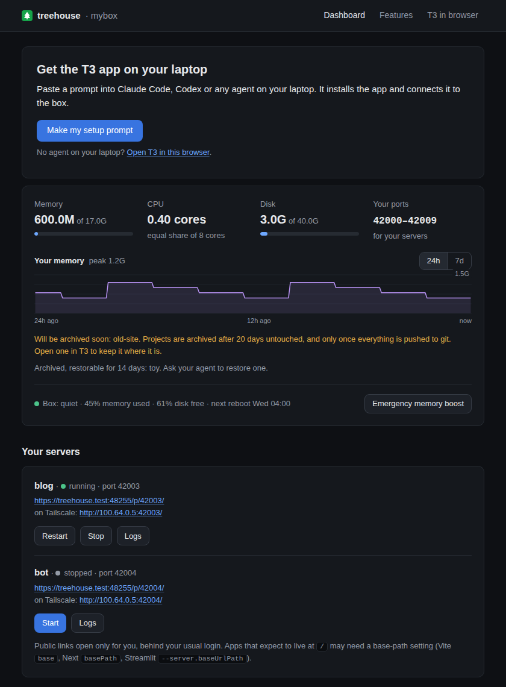

<div align="center">

# treehouse

### One spare computer, shared by your friends' AI coding agents.

Friends sign in from a browser. Their Claude Code, Codex and opencode sessions run on your machine,
each with the same generous, enforced limits as the owner. No VPN, no SSH keys, no per-friend setup.

`stdlib Python` · `systemd` · `cgroup v2` · no containers, no database

[](https://github.com/mh-anwar/treehouse/actions/workflows/lint.yml)
&nbsp; Ubuntu 24.04+ / Debian 13+ (tested on every change) · Omarchy / Arch (experimental)



</div>

---

## Why

AI agents made "I'll just code on my laptop" expensive: builds, dev servers, and five agent sessions at once.
Meanwhile there's an old desktop in a closet with 32 GB of RAM doing nothing.

treehouse turns that machine into a box your friends can actually use, including the non-technical ones:

1. You (or your agent) run `box invite --email friend@example.com`. Their account exists right away.
2. They open your site on any laptop or phone and type the code that gets emailed to them.
   No Tailscale, no app, no SSH key.
3. They land on their dashboard, log in to Claude or ChatGPT with a click, and open
   [T3 Code](https://t3.codes): an agent UI running on your box, with everything installed and the rules of the
   machine already explained to the agent.

No terminal, no VPN invites, no "can you run this command for me".

## What you get

**For friends**
- **Browser-only onboarding.** Signup, agent logins, GitHub login and a personal T3 Code web UI, all from one
  page (`/me`). Login codes are detected automatically.
- **Agents that know the house rules.** Every account's `CLAUDE.md` / `AGENTS.md` gets a short managed block:
  limits, ports, what gets cleaned up, how to install things without sudo, and live notices ("project X will be
  archived Friday", "the box reboots at 4 AM"). Details live in `box help <topic>`, read on demand, so the
  always-loaded part stays around a thousand tokens. Agents are told to do setup themselves and never send a
  non-technical person to a terminal.
- **Ready on first login.** Claude Code, Codex, opencode, node, Python + uv, git + gh, Go, rustup, build tools,
  headless-browser libraries, optionally a JDK and the Android SDK. `npm i -g` works without sudo.
- **Their own servers.** `box serve add NAME -- CMD` keeps a dev server or bot running across reboots, on the
  friend's own block of ports, with a link on their dashboard.
- **A terminal when they want one.** Technical friends can add an SSH key and use the `box` CLI. With the
  Cloudflare setup, a friend pastes one prompt into their laptop's own Claude Code or Codex and it sets up
  `ssh treehouse` through Cloudflare (no VPN), VS Code Remote-SSH included.

**For you (the owner)**
- **Equal limits, owner included.** Every account gets the same cgroup slice: 16 GB of RAM, no CPU cap (equal
  CPU weight shares it when several people want it), 2048 processes. A runaway agent stays inside its own
  slice. Nothing slows agents down on purpose: no naps, no build throttling.
- **Emergency boost.** `box boost` (or the dashboard button) raises your RAM to 28 GB for 4 hours when the box
  has it free. No approval needed; it ends by itself.
- **A janitor that never loses work.** A project (a git repo in a home folder) is archived only when it's
  untouched for 20 days *and* fully pushed; `box restore NAME` brings it back for 14 days. Unused caches go
  after 30 days, build outputs only when someone is over their disk budget. Cleanup runs *as the user*.
- **Tuned out of the box.** Compressed memory before swap (and a swap file if there's none), file-watch limits
  for many dev servers, network settings for the Cloudflare tunnel and phones. `box tune` shows what's left.
- **A dashboard** with live CPU and memory per person, disk against budget, running servers, package requests
  and events.
- **Health email.** A weekly report and hourly urgent checks: disk, failed services, SMART, pending updates, a
  security audit, and a section for what slowed agents down, which the agents log themselves with `box issue`.
- **Package requests without sudo.** `box request install PKG` installs ordinary packages from the distro's
  repos right away; anything on the deny list, or that would pull in too much, is emailed to you to approve.
- **Shared skills.** A catalog of agent skills every account can see (`box skills`), including a 4-model
  `council` review and Theo Browne's [tstack](https://github.com/t3dotgg/tstack) PR skills.
- **Self-updating.** Agents update nightly. Scheduled reboots twice a week (Wed and Sun at 04:00, configurable)
  wait up to 2 hours for agents that are mid-turn, and the dashboards show the next one. The owner's "Update
  treehouse" button installs the latest commit from a git checkout.
- **More than one machine.** List your boxes in `BOXES` and they show up as a Boxes card on your dashboard.
  `box run -- CMD` sends a heavy command to whichever box has room (or `--shards N` splits a test suite across
  them), and friends get the same account on every box. See [docs/multibox.md](docs/multibox.md).

<p align="center">

</p>

## Quick start

You need a Linux machine (Ubuntu 24.04+, Debian 13+, or Omarchy/Arch) and a coding agent that can reach it.
Then tell your agent:

```text
Set up treehouse on this machine. Follow https://github.com/mh-anwar/treehouse/blob/main/INSTALL.md
```

The agent checks the machine, asks you three questions, installs everything, tunes the machine, sets up email
alerts and the public sign-in page, checks it all works, and hands you an invite message for your first friend.
The only things you do yourself are click "approve" on a login page and maybe type your sudo password.

<details>
<summary>Doing it by hand instead</summary>

```bash
git clone https://github.com/mh-anwar/treehouse && cd treehouse
sudo ./install.sh                                    # dry run: prints every action, changes nothing
sudo ./install.sh --apply --admins you --mail-to you@example.com
sudo bash /usr/share/sharedbox/cloudflare-setup.sh   # optional: the public sign-in page (needs a domain on Cloudflare)
box invite --email friend@example.com                # their account, and the email they sign in with
```
</details>

The installer is additive and safe on a live machine. It never touches sshd, tailscaled or the firewall, never
restarts networking (its network tuning applies live), and never reboots. It does rewrite every account's
limits to the current config (equal for everyone). `./uninstall.sh` removes it again and keeps people's
accounts and files.

**Requirements:** Linux with systemd and cgroup v2, Python 3.12 or newer, Tailscale on the server (friends
don't need it), and for the public sign-in page a domain on Cloudflare (the free plan is enough). Ubuntu 22.04
and Debian 12 ship an older Python and aren't supported. Omarchy/Arch support is new: please
[open an issue](../../issues) with what breaks.

## How it works

The recommended setup puts the box behind Cloudflare Access and a Cloudflare Tunnel. Friends open your site
(say `https://treehouse.example.com`), type their email and the code Cloudflare sends them, and only emails you
invited get through. The tunnel only makes outbound connections: nothing on the box listens on the internet.

```
 friend's browser ─▶ Cloudflare Access (email code; only invited emails)
                          │  Cloudflare Tunnel (cloudflared, outbound only)
                          ▼
                 sharedbox-gate (unprivileged, 127.0.0.1) checks Cloudflare's signed token on every request
                   │ /_box/*: dashboard, logins            │ everything else
                   ▼                                       ▼
          sharedbox-web (unprivileged)          the friend's own T3 Code (started on
                   │ drops a request in a spool dir      the first visit)
                   ▼
          sharedbox-admin (root, path-activated): re-verifies the token itself,
          creates the account / runs the action AS the friend
                   │
     ┌─────────────┼──────────────────────┐
     ▼             ▼                      ▼
 user-UID.slice  agent rule files     janitor: cleanup as the user,
 limits, boost   + session snapshot   archives, notices
```

Without a domain, treehouse runs **Tailscale only**: each friend joins your tailnet, and the dashboard and
`/join` page trust `tailscale whois`. Nothing is public. Self-signup there is either on (`JOIN_MODE=open`,
an account is created right away) or off (`closed`, invites only).

| | Per account, owner included (default) | Mechanism |
|---|---|---|
| CPU | no cap; equal weight (100) for everyone | `CPUWeight` |
| RAM | 16G soft, 17G hard; `box boost`: 28G for 4 h | `MemoryHigh`, `MemoryMax` |
| Disk | 40G budget, soft-enforced | janitor |
| Processes | 2048 | `TasksMax` |

Everything is tunable in `/etc/sharedbox/sharedbox.conf` (documented inline), and per person with
`sharedbox-admin limits NAME KEY=VALUE`.

<details>
<summary><b>The janitor, in detail</b></summary>

Every 6 hours it measures each home as root, then runs the cleanup **as that user** (`setpriv`), so symlink
tricks can't redirect deletions.

| What | When |
|---|---|
| Cache entries (`~/.cache/*`, npm, Gradle, Cargo, Go, uv, …) | unused 30 days, or now if over budget |
| Build outputs (`node_modules`, `.venv`, `target`, …) | only when over budget |
| A project (a git repo directly in `~`) | untouched 20 days, no process, no service, **and fully pushed** (a remote, clean tree, no untracked files, every branch pushed, no stash): **archived** to `~/.sharedbox/archive/` (announced 3 days ahead). Non-git folders and unpushed work: never |
| An archived project | 14 days after archiving (`box restore NAME` until then), or first when over budget |
| `box run` copies on another box (`~/.sharedbox/mirror`) | unused 7 days |
| `~/services`, `~/keep`, dotfiles | never |

Below 20% free disk all TTLs halve; below 10% caches are wiped.
</details>

<details>
<summary><b>T3 Code</b></summary>

Each friend gets their own T3 Code server, started on their first visit and paired with their browser
automatically. It stays on T3's stable channel unless `TOOLS_NPM` opts in to `t3@nightly`; before a friend's T3
starts on a newer version, the box saves a copy of their T3 database in `~/.t3/sb-backup/`, and it never moves
T3 to an older version by itself.

The owner's own T3 can keep running as T3's own service. `box t3 switch` moves it under the box (`box t3
status`, `box t3 logs`): it waits for ten quiet minutes with no agent working, switches once, checks the new
server answers, and puts the old one back if it doesn't. Installing or updating treehouse never does this on its
own.
</details>

<details>
<summary><b>Solo mode (one person, no friends)</b></summary>

Set `SOLO=1` in `/etc/sharedbox/sharedbox.conf` and re-run `sudo ./install.sh --apply`. treehouse then runs as a
lean personal server: limits, `box boost`, the janitor, agent rules, `box serve`, health email and T3 all work
as usual, and the friend-only parts (signups, invites, Cloudflare seat alerts) are off.
</details>

<details>
<summary><b>Admin cheat sheet</b></summary>

```
box invite [--email ADDR] [--note WHO]  # owner accounts, no sudo
box friends [suspend|remove|requests|boxes ...]   # owner accounts, no sudo (`box friends --help`)
box skills share DIR | unshare NAME     # owner accounts, no sudo: publish a skill to everyone
sharedbox-admin list | invite | issues | requests
sharedbox-admin limits NAME MEMORY_HIGH=10G MEMORY_MAX=11G DISK_BUDGET_GB=50
sharedbox-admin boost NAME [--why TEXT] # same as `box boost` for that account
sharedbox-admin suspend NAME | resume NAME | remove NAME --archive
sharedbox-tools add pkg ffmpeg          # install for everyone, remembered across reinstalls
sharedbox-health report | test-email
```
</details>

<details>
<summary><b>Security model</b></summary>

- **Cloudflare (public):** Cloudflare Access is the first lock. Only emails on your allow list
  (`box invite --email`) ever reach the box, and the tunnel only makes outbound connections. The gate is the
  second lock: it verifies Cloudflare's signed token (audience, expiry, signing keys) on every request, and root
  verifies it again before any account or portal action. Accounts come from invites only.
- **Tailscale only (private):** the box is never on the public internet; Tailscale identity (`tailscale whois`)
  is what signup and the `/me` page trust. Self-signups must give an email.
- T3 Code is each friend's own server, reachable only through the gate (or the tailnet) and paired per browser.
- The web service and the gate are unprivileged and sandboxed; a root path unit re-validates every request.
  Requests from the box itself are rejected, so a local user can't pretend to be the owner.
- Friend homes are `0700`. No sudo, no docker group. Everything that touches a friend's files (cleanup,
  archiving, starting T3 for scheduled tasks) runs as that friend.
- See [SECURITY.md](SECURITY.md) to report a vulnerability.
</details>

## Testing

Everything runs from a checkout with no root and no network:

```bash
python3 -m unittest discover -s tests       # unit tests, stdlib only
python3 tests/e2e_gate.py .                  # the real gate against fake logins and backends
uv run --no-project --with playwright python tests/e2e_browser.py . --quick   # every page, per persona, in Chromium
tests/container/run.sh                       # install, update, uninstall in throwaway Ubuntu and Debian containers
FROM=<older commit> tests/container/run.sh   # start on an older version and update, like a live box does
```

CI runs the unit tests, the gate test and the container install test on Ubuntu 24.04 and Debian 13 for every
pull request.

## Roadmap

- Several boxes behind one sign-in page: each account gets a home box, and the gate routes to it (the hook,
  `backend_for()`, is there; today each box has its own site)
- Owner buttons on the dashboard for invite, suspend and remove (today the owner's agent does it with
  `box friends`, no sudo needed)
- Omarchy/Arch: a first real-hardware install
- Hard disk quotas where the filesystem supports them
- ntfy/Discord notifications

## Contributing

PRs welcome; read [CONTRIBUTING.md](CONTRIBUTING.md) first. treehouse used to be called sharedbox, and the
commands, paths and services still are (`sharedbox-admin`, `/etc/sharedbox`). The code is plain stdlib Python
and bash, so there's nothing to build.

## License

[MIT](LICENSE)
