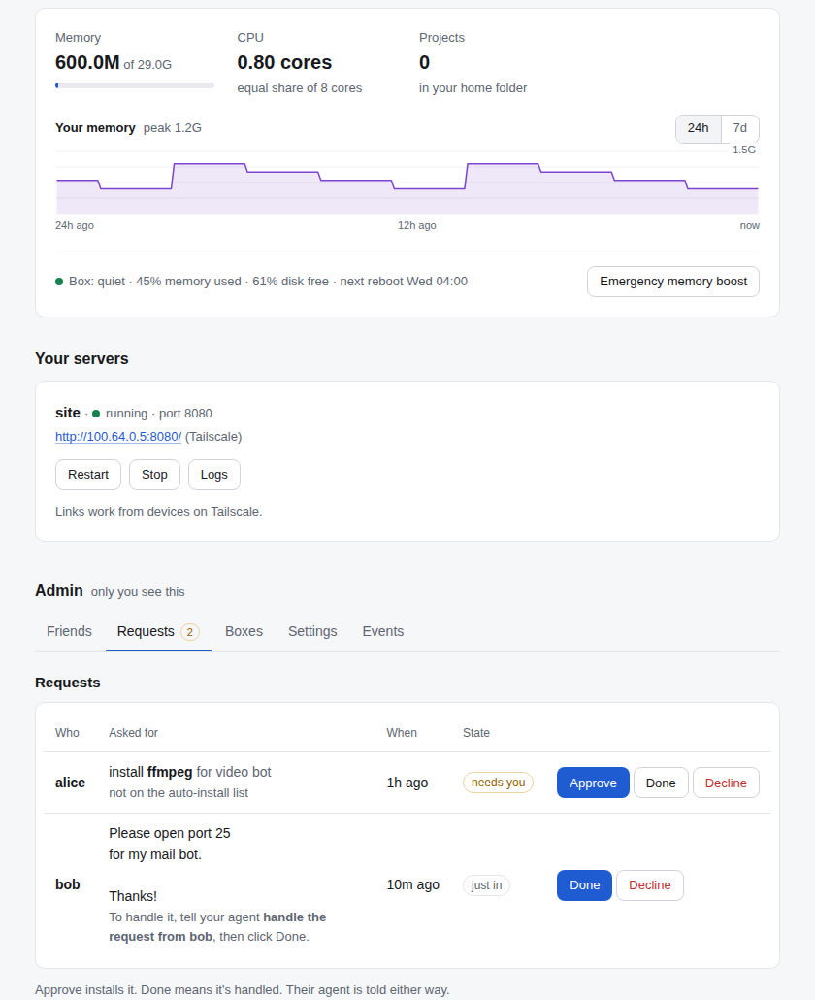

# treehouse

[](https://github.com/mh-anwar/treehouse/actions/workflows/lint.yml)

treehouse turns a spare Linux machine into a shared server for your friends' AI coding agents. Friends sign in from a browser and run Claude Code, Codex and opencode on your machine. Every account, yours included, gets the same resource limits. It is plain Python (standard library only) and bash on top of systemd and cgroup v2, with no containers and no database.

It runs on Ubuntu 24.04+, Debian 13+ and Arch Linux, which CI tests on every change. Omarchy is Arch with a desktop on top, so it should work too, but it isn't tested on its own.

<p align="center">

</p>

## What it does

You invite a friend with `box invite --email friend@example.com`. They open your site, type the code emailed to them, and land on their dashboard (`/me`). From there they can log in to Claude, ChatGPT and GitHub and open their own [T3 Code](https://t3.codes), a web UI for coding agents. They don't need a VPN, an SSH key or a terminal. Friends who want a terminal can add an SSH key and use the `box` command.

Each account comes with Claude Code, Codex, opencode, Node, Python with uv, git, gh, Go, rustup and build tools installed. `npm i -g` works without sudo. Every account's `CLAUDE.md` and `AGENTS.md` gets a short managed section with the machine's rules (limits, ports, cleanup, how to install things without sudo) and current notices such as an upcoming reboot. Agents read more with `box help <topic>`.

Other features:

- `box serve add NAME -- CMD` keeps a server running across reboots on the friend's own ports, with a link on their dashboard.
- `box boost` raises your RAM limit to 28 GB for 4 hours if the machine has it free.
- A janitor cleans old caches and archives projects nobody has touched (details below).
- `box request install PKG` installs ordinary distro packages right away. Anything on the deny list, or anything that pulls in too much, is emailed to the owner to approve.
- A weekly health email and hourly urgent checks cover disk, failed services, SMART, pending updates, a security audit, and problems agents report with `box issue`.
- `box skills` lists shared agent skills, including a 4-model `council` review and Theo Browne's [tstack](https://github.com/t3dotgg/tstack) PR skills.
- Agents update nightly. The machine reboots Wednesday and Sunday at 04:00 (configurable) and waits up to 2 hours for agents that are mid-turn.
- With several machines listed in `BOXES`, `box run -- CMD` sends a command to whichever one has room. See [docs/multibox.md](docs/multibox.md).

The owner's dashboard also shows everyone's CPU and memory, disk use, servers, package requests and events.

<p align="center">

</p>

## Install

You need Linux with systemd and cgroup v2, Python 3.12 or newer, and Tailscale on the server. For the public sign-in page you also need a domain on Cloudflare (the free plan works). Ubuntu 22.04 and Debian 12 ship an older Python and are not supported.

The easiest way is to ask a coding agent on the machine:

```text
Set up treehouse on this machine. Follow https://github.com/mh-anwar/treehouse/blob/main/INSTALL.md
```

It asks you three questions, installs and tunes everything, sets up email alerts and the sign-in page, and gives you an invite message for your first friend. You may need to approve a login and type your sudo password.

By hand:

```bash
git clone https://github.com/mh-anwar/treehouse && cd treehouse
sudo ./install.sh                                    # dry run: prints every action, changes nothing
sudo ./install.sh --apply --admins you --mail-to you@example.com
sudo bash /usr/share/sharedbox/cloudflare-setup.sh   # optional: the public sign-in page
box invite --email friend@example.com
```

An old PC or laptop works. The dry run says what to expect from its RAM and disk, and the installer turns off sleep and lid-close suspend so the machine stays reachable (`TUNE_KEEP_AWAKE=0` in the config keeps your sleep settings). The coding agents need a 64-bit CPU.

The installer is safe to re-run on a live machine. It does not touch sshd, tailscaled, the firewall or networking, and it never reboots. It does reset every account's limits to the values in the config. `./uninstall.sh` removes treehouse and keeps accounts and files.

Commands, paths and services still use the name sharedbox (`sharedbox-admin`, `/etc/sharedbox`).

## How it works

With Cloudflare, friends reach the machine through Cloudflare Access and a Cloudflare Tunnel. Only invited emails get past Access, and the tunnel only makes outbound connections, so nothing on the machine listens on the internet.

```
 friend's browser -> Cloudflare Access (email code; only invited emails)
                          |  Cloudflare Tunnel (outbound only)
                          v
                 sharedbox-gate (unprivileged) checks Cloudflare's signed token on every request
                   | /_box/*: dashboard, logins            | everything else
                   v                                       v
          sharedbox-web (unprivileged)          the friend's own T3 Code
                   | writes a request to a spool dir
                   v
          sharedbox-admin (root): checks the token again, then
          creates the account or runs the action as the friend
```

Without a domain, treehouse runs over Tailscale only. Each friend joins your tailnet, and the dashboard trusts `tailscale whois`. `JOIN_MODE=open` lets people sign up at `/join`; otherwise it's invites only.

Default limits per account:

| | Limit | Mechanism |
|---|---|---|
| CPU | no cap, equal weight (100) | `CPUWeight` |
| RAM | 16G soft, 17G hard; 28G for 4 h with `box boost` | `MemoryHigh`, `MemoryMax` |
| Disk | 40G budget, soft | janitor |
| Processes | 2048 | `TasksMax` |

On a machine with less than 20 GB of RAM, a new install sets the RAM limits to 70% and 80% of what the machine has (5G and 6G on 8 GB). Change them in `/etc/sharedbox/sharedbox.conf` (each setting is documented there), or for one person with `sharedbox-admin limits NAME KEY=VALUE`.

The janitor runs every 6 hours and does its cleanup as the user. It removes cache entries unused for 30 days, and build outputs (`node_modules`, `.venv`, `target`) only when someone is over their disk budget. A project (a git repo directly in a home folder) is archived after 20 days untouched, and only if everything in it is pushed. `box restore NAME` brings it back within 14 days. `~/services`, `~/keep` and dotfiles are never touched. Below 20% free disk the time limits halve, and below 10% caches are wiped.

Each friend's T3 Code server starts on their first visit. Before T3 moves to a newer version, the box copies their T3 database to `~/.t3/sb-backup/`.

Set `SOLO=1` in the config and re-run `sudo ./install.sh --apply` to use treehouse on a machine with just you. Signups and invites turn off; everything else keeps working.

Admin commands:

```
box invite [--email ADDR] [--note WHO]
box friends [suspend|remove|requests|boxes ...]
box skills share DIR | unshare NAME
sharedbox-admin list | invite | issues | requests
sharedbox-admin limits NAME MEMORY_HIGH=10G MEMORY_MAX=11G DISK_BUDGET_GB=50
sharedbox-admin suspend NAME | resume NAME | remove NAME --archive
sharedbox-tools add pkg ffmpeg
sharedbox-health report | test-email
```

## Security

The gate and web service run unprivileged and sandboxed. Root checks Cloudflare's token again before any account or portal action and rejects requests that come from the machine itself. Friend homes are `0700`, and friends get no sudo and no docker group. Anything that touches a friend's files runs as that friend. To report a vulnerability, see [SECURITY.md](SECURITY.md).

## Tests

These run from a checkout without root. Only the container tests need the network:

```bash
python3 -m unittest discover -s tests       # unit tests
python3 tests/e2e_gate.py .                  # the gate against fake logins and backends
uv run --no-project --with playwright python tests/e2e_browser.py . --quick   # every page in Chromium
tests/container/run.sh                       # install, update and uninstall in Ubuntu and Debian containers
FROM=<older commit> tests/container/run.sh   # update from an older version
SCENARIO=agents tests/container/run.sh       # full install with the agents, then every tool checked as a friend
SCENARIO=t3switch tests/container/run.sh     # box t3 switch: waits for agents, rolls back, then switches
```

The container tests need rootless Docker or Podman. The agents test downloads a few GB and takes 10 to 15
minutes; the T3 switch test uses a stand-in `t3` and takes about two. CI runs all of them for every pull request:
the install test on Ubuntu 24.04, Debian 13 and Arch, the agents and T3 switch tests on Debian 13.

## Contributing

Read [CONTRIBUTING.md](CONTRIBUTING.md) first. There is nothing to build.

## License

[MIT](LICENSE)
